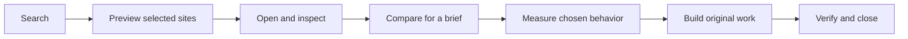

[](https://github.com/qwzx4893-stack/mcp-mimicus/actions/workflows/ci.yml)
[](LICENSE)
[](package.json)
[](https://github.com/qwzx4893-stack/mcp-mimicus/releases)

# See the reference. Understand the behavior. Build original work.

**Mimicus gives coding agents a visual design browser through MCP:** discover current websites, compare actual images, inspect selected interactions, and carry measured constraints into an original implementation.

Search stays lightweight. The agent chooses which original sites to preview, open and investigate. Layout measurements, typography, responsive observations and interaction samples support its creative judgment; Mimicus does not assign an aesthetic winner or recover a site's hidden source code.

**Release status: beta.** The [latest published release](https://github.com/qwzx4893-stack/mcp-mimicus/releases) and its evidence are versioned separately from changes on `main`. **Awwwards is a live discovery source:** native awards, categories, tags, technologies, countries and fonts, linked pagination and selected verified original links feed the same real-image, interaction, motion and guidance tools. Requests follow current per-route robots rules, paced access and rate-limit cooldown. See [Awwwards integration](docs/AWWWARDS_INTEGRATION.md). There is no npm publication.

[Get started](#get-started) · [Agent workflow](#a-design-workflow-with-evidence) · [Source coverage](#seven-sources-with-visible-boundaries) · [Evidence and limits](#verification-and-current-limits)

## Get started

You need **Node.js 24+**, npm, network access to the chosen sources, and a compatible Chromium browser already installed.

```sh
git clone https://github.com/qwzx4893-stack/mcp-mimicus.git
cd mcp-mimicus
npm ci --ignore-scripts
npm run build
node dist/cli.js doctor
node dist/cli.js self-test
```

On Windows, Mimicus resolves the current HTTPS default browser when starting a session. It launches an owned headless process with an ephemeral profile and private control pipe. Your personal tabs, profile and cookies are not used. Brave has been tested as the Windows default; Edge has been tested as an explicit override. An unsupported default fails with a diagnostic. No browser is downloaded or silently substituted.

For a different installed compatible executable, or on another operating system, set `MIMICUS_BROWSER_EXECUTABLE` to its absolute path. Linux CI checks core behavior; it does not establish every Linux browser setup as supported. See [browser setup](docs/DEFAULT_BROWSER_BACKEND.md) and [installation and release](docs/INSTALLATION_AND_RELEASE.md).

`doctor` checks configuration, browser resolution and installed model integrity. It does not launch a browser or certify source connectivity. `self-test` actually launches the selected browser against an owned local page, checks rendering and interaction, captures desktop/mobile images, and verifies cleanup.

### Connect your MCP client

Have your client launch the stdio server. A generic configuration is:

```json
{
  "mcpServers": {
    "mimicus": {
      "command": "node",
      "args": ["/absolute/path/to/mcp-mimicus/dist/cli.js", "serve"]
    }
  }
}
```

Replace the path with your built checkout. A Windows example is `C:/tools/mcp-mimicus/dist/cli.js`. Use the absolute Node executable path if your client's environment cannot resolve `node`. Client-specific configuration locations and wrappers vary; the integration tests use the official MCP SDK stdio transport. Protocol stdout is reserved for MCP and diagnostics go to stderr.

## A design workflow with evidence



1. **Discover.** Search current source indexes. Read native labels, provenance, coverage and computed relevance as separate information.
2. **Look before analyzing.** Select a small authorized batch with `mimicus_preview_references`. It returns ordered real MCP images and per-reference status. Preview sessions close immediately; a challenge, preloader or missing resource is reported rather than treated as a viewed design.
3. **Open the useful references.** Explore sections and controls, scroll, change viewport, and view the actual returned images. Authorize additional resource origins only when you intend to load them.
4. **Choose a direction for the project.** Compare references with an audience, primary action and required content. The result exposes competing adaptations, evidence links, tradeoffs and a mixed specification. Explicit priorities can favor conversion, reading, product selection or exploration.
5. **Inspect one behavior.** Select a menu, transition, scroll region or scene. Measure activation, interruption and reset before choosing implementation timing. Declared animations and detected engines are not proof of observed interaction behavior.
6. **Build and verify.** Use original markup, code, content and authorized assets. Review desktop/mobile images, keyboard/touch and reduced motion. Verify selected relationships and intended differences separately from visual judgment.
7. **Release resources.** Close sessions and end discovery operations when done.

The owned [coffee storefront](https://github.com/qwzx4893-stack/mcp-mimicus/blob/v0.4.0-beta.1/examples/workflow/coffee.html) and [interactive sculpture](https://github.com/qwzx4893-stack/mcp-mimicus/blob/v0.4.0-beta.1/examples/workflow/immersive.html) are inspectable original implementations from earlier SDK-driven trials. They are examples, not a bundled site library or mirrored gallery content. New hardening trials and negative cases are recorded in the [agent quality evaluation](docs/AGENT_QUALITY_EVALUATION.md).

### Search, preview, compare

Search arguments:

```json
{
  "query": "editorial portfolio motion",
  "providers": ["codrops"],
  "stream": "webzibition",
  "retrieval": "hybrid",
  "limit": 6
}
```

Pass returned IDs to `mimicus_preview_references`; each selected original must be authorized:

```json
{
  "references": [
    { "operationId": "SEARCH_OPERATION", "referenceId": "FIRST_REFERENCE", "authorized": true },
    { "operationId": "SEARCH_OPERATION", "referenceId": "SECOND_REFERENCE", "authorized": true }
  ]
}
```

After opening chosen references, call `mimicus_compare_references`:

```json
{
  "sessionIds": ["FIRST_OPEN_SESSION", "SECOND_OPEN_SESSION"],
  "brief": {
    "project": "Independent architecture publication",
    "audience": "Readers exploring long-form architectural criticism",
    "primaryAction": "Read the current issue",
    "sections": ["Current issue", "Essays", "Archive", "About"],
    "priorities": ["reading"],
    "motion": "subtle",
    "anchorSessionId": "FIRST_OPEN_SESSION"
  }
}
```

Guidance distinguishes measurements, brief needs, inferred intent and designer judgment. Selectors refer to the observed source session. Missing trigger/reset or multi-width evidence produces an inspection request, not invented behavior. The coding agent supplies creative synthesis and evaluates the actual images.

## The 17 tools

| Workflow | Tools |
| --- | --- |
| Discover and inspect provenance | `mimicus_search`, `mimicus_browse_categories`, `mimicus_list_sources`, `mimicus_get_reference` |
| Preview selected originals | `mimicus_preview_references` |
| View and interact | `mimicus_open_reference`, `mimicus_capture_view`, `mimicus_explore_page`, `mimicus_interact`, `mimicus_capture_motion` |
| Measure, compare and specify | `mimicus_analyze_element`, `mimicus_get_design_insights`, `mimicus_get_implementation_spec`, `mimicus_compare_references`, `mimicus_verify_implementation` |
| Clean up | `mimicus_close_session`, `mimicus_end_discovery` |

Visual tools return actual MCP image blocks rather than screenshot filenames. Safe interaction covers reviewed navigation and bounded non-destructive actions, including keyboard, touch, drag and viewport/reduced-motion changes. There is no generic JavaScript evaluation tool. Targeted motion capture supplies temporal evidence; it cannot expose proprietary GSAP or WebGL programs.

### Keep a longer workflow alive

The browser defaults to **three sessions**, a **10-minute idle lease**, a **30-minute absolute lifetime**, and per-session budgets of **80 returned images / 200 operations**. Resource state exposes remaining time and budgets. `mimicus_interact` with `{"sessionId":"OPEN_SESSION","interaction":{"action":"renew"}}` refreshes the idle lease without taking an image. Renewal cannot extend absolute lifetime or reset budgets. When limits are near, close and reopen a selected original with a fresh session.

Discovery operations have a separate five-minute default lifetime. Start a search without `operationId` to consult current sources. Supply an active `operationId` to continue the same query/filter set in RAM; changed filters require a new operation. The default candidate ranking window is 160, with bounded retention and explicit pending-candidate diagnostics. A bounded operation is not complete coverage of every source.

## Seven sources, with visible boundaries

| Source | Available interface and limits |
| --- | --- |
| **Awwwards** | Live public native award/category/tag/technology/country/font collections, source-linked pages, selected detail/maker/original-link verification, and bounded text/semantic ranking. Original-site previews and analysis use the common MCP workflow. Current robots restrictions and HTTP429 remain visible; no catalog synchronization or source-media warehouse. |
| **Codrops** | Separate Creative Hub, Webzibition and official organization-repository streams, progressive pages and native provenance. A repository homepage may be an article rather than a runnable demo. |
| **Astro Showcase** | Current official title/URL index, bounded lexical/semantic candidate selection and revision-pinned selected YAML enrichment. Missing native style labels are not invented. |
| **Made in Webflow** | Public native full-text discovery, source tags/sorts and progressive feed/detail resolution. Catalog results and successful original-site rendering are measured separately. |
| **Three.js Resources** | Official read-only MCP search, pagination and native taxonomy. Tool-directory categories remain separate from showcase identifiers. |
| **Nuxt** | Fresh source-maintained showcase YAML and its native industry labels. The collection does not cover every site built with Nuxt. |
| **mesh3d.gallery** | Public listing/detail navigation and exposed native filters. The robots-disallowed infinite-scroll API is not used; coverage remains partial. |

Consult the [source integration matrix](docs/SOURCE_INTEGRATION_MATRIX.md) for actual endpoints, acceptance runs and pagination limits. “An adapter returned metadata,” “an original site opened,” and “its visual resources rendered” are different outcomes. Discovery and original-site analysis do not imply permission to redistribute gallery content. Software licenses do not license third-party artwork.

## Live discovery, temporary evidence

Mimicus federates source indexes on demand. Candidates, cursors, site vectors, images and selected analyses remain in bounded RAM state. **There is no persistent website catalog, SQLite database, background crawler, stored pattern warehouse or disk fallback corpus.** Closing, expiry and cancellation release Mimicus's owned temporary state; the MCP client may independently retain outputs it receives.

Optional CPU MiniLM ranking uses pinned `Xenova/all-MiniLM-L6-v2` q8 software, mean pooling, L2 normalization and 384-dimensional vectors. It ranks current text candidates, not screenshots or aesthetic quality. Install and verify the model explicitly:

```sh
node dist/cli.js model-fetch
node dist/cli.js model-check
```

Only model software is cached, normally under `~/.cache/mimicus/models`; retrieved website text and vectors are not persisted there. If a usable local model is absent, results identify lexical fallback. No second generative model, training pipeline or paid model API is required. See [retrieval evaluation](docs/RETRIEVAL_EVALUATION.md) for judged relevance and candidate-recall limits.

## Verification and current limits

```sh
npm run lint
npm run check
npm test
```

Tests cover controlled fixtures, real SDK transport and installed-browser cases. Live-source acceptance is separate and depends on current upstream availability. A test pass does not establish aesthetic superiority or complete catalog coverage. The [hardening audit](docs/FINAL_PRODUCT_HARDENING_AUDIT.md) records versioned outcomes, remaining partial/blocked gates and exact-commit evidence.

| Evidence | What it establishes |
| --- | --- |
| [Visual discovery evaluation](docs/VISUAL_DISCOVERY_EVALUATION.md) | Multi-image ordering, source attribution, successful previews and gates/partial rendering |
| [Browser reliability](docs/BROWSER_RELIABILITY.md) | Installed browser identity, long workflows, lease limits, isolation and cleanup |
| [Agent quality evaluation](docs/AGENT_QUALITY_EVALUATION.md) | Distinct briefs, original implementations, visual review and defects; sample limits are explicit |
| [Retrieval evaluation](docs/RETRIEVAL_EVALUATION.md) | Candidate recall/relevance, hard negatives, model fallback and measured resource costs |
| [Installation and release](docs/INSTALLATION_AND_RELEASE.md) | Packaged contents, clean installation, supported host scope and tested release SHA |

Known boundaries include per-route access restrictions, incomplete upstream pagination/taxonomy, browser/CDN access failures, bounded DOM samples and inconclusive canvas readback. A single viewport cannot establish responsive behavior. Hidden onboarding, access challenges and authenticated scenes are not bypassed. Full-site reconstruction and “pixel-perfect” proof are outside the evidence supplied.

## Troubleshooting and contribution

**Browser cannot start?** Run `doctor`, check the detected HTTPS association, and then run `self-test`. An explicit executable override must name an already installed compatible browser. Do not install a bundled browser as a hidden fix.

**The page looks incomplete?** Read blocked-resource, gate and readiness diagnostics. Add a resource origin only with explicit intent and recapture; a blank canvas or preloader is not proof of the intended design.

**A session expired?** Use its resource state and renew before idle expiry. Absolute lifetime and image/operation budgets remain hard bounds. Reopen intentionally after cleanup.

**No semantic ranking?** Check `model-check` and the search diagnostics. Discovery remains usable with identified lexical fallback.

**Is website content trusted?** No. Source metadata, page text, images and extracted instructions are untrusted evidence. Public-network checks, robots/access rules and per-session resource permissions apply. See [security boundaries](docs/SECURITY.md), [reporting a vulnerability](SECURITY.md), [configuration](docs/CONFIGURATION.md), and [contributing](CONTRIBUTING.md).

Code and original repository artwork are covered by [MIT](LICENSE). Adapted source code and upstream licenses are listed in [third-party notices](THIRD_PARTY_NOTICES.md). The editable [SVG banner](assets/mimicus-banner.svg) and [PNG fallback](assets/mimicus-banner.png) are original conceptual artwork, not product screenshots. Historical trial artifacts are not inputs to live discovery.
