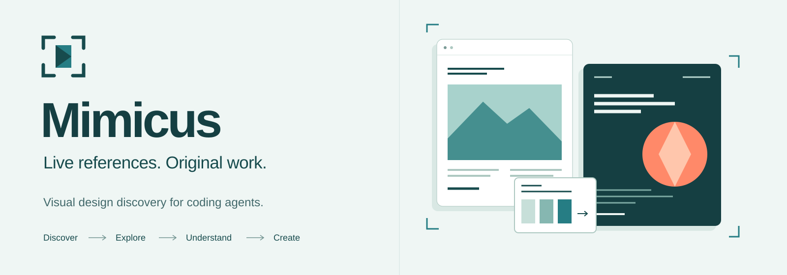

[](LICENSE)
[](package.json)
[](https://github.com/qwzx4893-stack/mcp-mimicus/actions/workflows/ci.yml)

# Mimicus

**A live visual design reference browser for coding agents, exposed through MCP.**

Find current references across curated sources, inspect selected original websites as actual images, and measure the layout or behavior needed for an original implementation. Mimicus helps an agent look, compare and verify; it does not generate a website, judge aesthetic quality, or recover another site's source code.

**0.3.0-beta.2** is a [source beta](https://github.com/qwzx4893-stack/mcp-mimicus/releases/tag/v0.3.0-beta.2) from [qwzx4893-stack/mcp-mimicus](https://github.com/qwzx4893-stack/mcp-mimicus). npm publication is not part of this release. Browser compatibility and upstream source interfaces remain beta limitations.

## Start locally

Requires **Node.js 24+**, npm, and an installed compatible Chromium browser. Discovery also needs access to the selected public sources.

```sh
git clone https://github.com/qwzx4893-stack/mcp-mimicus.git
cd mcp-mimicus
npm ci --ignore-scripts
npm run build
node dist/cli.js doctor
node dist/cli.js self-test
```

On Windows, Mimicus resolves the actual installed HTTPS default browser, including Brave when it is the default. It launches that executable headlessly with a separate temporary profile and private control pipe. It does not open your personal profile, download a browser, or silently fall back to a bundled browser. An unsupported default produces an actionable error.

On other operating systems, or to explicitly select a different installed compatible browser, set `MIMICUS_BROWSER_EXECUTABLE` to its absolute executable path. Custom Chromium builds are checked by actual launch; universal compatibility is not promised. See [browser setup and diagnostics](docs/DEFAULT_BROWSER_BACKEND.md).

`doctor` checks configuration, executable resolution and available model integrity; it does **not** claim the browser launched or that sources connected. `self-test` launches the selected browser against an owned local page and checks rendering, interaction, responsive capture and cleanup. It is separate from live-source acceptance.

## Connect an MCP client

Start the stdio server with `node dist/cli.js serve`, or let your MCP client launch it. A generic configuration is:

```json
{
  "mcpServers": {
    "mimicus": {
      "command": "node",
      "args": ["/absolute/path/to/mcp-mimicus/dist/cli.js", "serve"]
    }
  }
}
```

Replace the path with your built checkout; on Windows, for example, use `C:/path/to/mcp-mimicus/dist/cli.js`. If the client cannot resolve Node through `PATH`, provide its absolute executable path too. The surrounding configuration format depends on your client. The release trials used the official MCP SDK stdio client; they do not establish acceptance in every named desktop client. Protocol stdout is reserved for MCP; diagnostics use stderr.

## Use it in a design workflow

1. Search by project intent. Inspect source coverage, provenance, native labels and any computed relevance separately.
2. Select a reference and open its original URL with explicit authorization. **View the returned MCP image**, then explore the relevant sections, responsive states and controls.
3. Compare selected open references with a concrete project brief: audience, primary action, sections and motion preference. The result combines measurements with independently written guidance; the agent chooses the direction.
4. Analyze a specific element or behavior, obtain its temporary implementation specification, and build original code, content and authorized assets.
5. Inspect the implementation at desktop and mobile widths, exercise keyboard/touch and reduced motion, and verify the chosen measured constraints. A deliberate difference can be correct for the brief.
6. Close sessions and discovery operations when finished.

Example search and project-aware comparison arguments:

```json
{"name":"mimicus_search","arguments":{"query":"editorial portfolio motion","providers":["codrops"],"stream":"webzibition","retrieval":"hybrid","limit":6}}
```

```json
{
  "name": "mimicus_compare_references",
  "arguments": {
    "sessionIds": ["FIRST_OPEN_SESSION", "SECOND_OPEN_SESSION"],
    "brief": {
      "project": "Independent design studio portfolio",
      "audience": "Prospective clients reviewing recent work",
      "primaryAction": "Open a relevant case study",
      "sections": ["Selected work", "Studio approach", "Contact"],
      "motion": "subtle",
      "anchorSessionId": "FIRST_OPEN_SESSION"
    }
  }
}
```

A new search without `operationId` fetches current source data. Passing an active `operationId` explicitly continues the same query and filters in RAM; changed filters require a new operation. Use the source's diagnostics rather than interpreting a bounded result set as complete coverage.

## The 16 tools

| Task | Tools |
| --- | --- |
| Discover and inspect provenance | `mimicus_search`, `mimicus_browse_categories`, `mimicus_list_sources`, `mimicus_get_reference` |
| View and explore original sites | `mimicus_open_reference`, `mimicus_capture_view`, `mimicus_explore_page`, `mimicus_interact`, `mimicus_capture_motion` |
| Analyze and guide original work | `mimicus_analyze_element`, `mimicus_get_design_insights`, `mimicus_get_implementation_spec`, `mimicus_compare_references`, `mimicus_verify_implementation` |
| Release temporary state | `mimicus_close_session`, `mimicus_end_discovery` |

Visual tools return actual MCP image blocks, not screenshot file paths. Interaction is constrained to reviewed navigation and bounded, non-destructive actions; there is no generic JavaScript evaluation tool. Additional public resource origins require explicit per-session approval. Robots restrictions, access challenges and authentication are not bypassed.

## Seven source adapters, explicit coverage

| Source | Live interface and practical scope |
| --- | --- |
| Awwwards | MIT adapter code and operator-supplied original-reference handoff are retained. Automated gallery extraction, details and source-owned media remain restricted without reviewed authorization; no special license is assumed. |
| Codrops | Separate Creative Hub, Webzibition and official organization repository streams, with progressive pages and source-native provenance. Repository homepages can lead to articles rather than demos. |
| Astro | Current official title/URL index participates in lexical selection; bounded selected YAML records are enriched. This is not complete semantic/style search across every entry. |
| Made in Webflow | Source-provided full-text search, native tags/sorts and progressive public feed/detail resolution. Coverage and original-site reachability remain separate. |
| Three.js Resources | Official read-only MCP native search and pagination. Tool-directory taxonomy stays separate from opaque showcase tag IDs. |
| Nuxt | The current official source-maintained showcase YAML, fetched anew. It covers that collection, not all Nuxt websites. |
| mesh3d.gallery | Public listing/detail links and exposed native filters. The robots-disallowed infinite-scroll API is not used, so gallery coverage is partial. |

Six adapters returned current candidates in release acceptance; Awwwards restriction was verified with zero automated gallery requests. Using a gallery to identify an original site, visiting that original site, and reusing gallery metadata or media are distinct permissions. MIT software licensing does not license third-party website content. See [source integration matrix](docs/SOURCE_INTEGRATION_MATRIX.md).

## Temporary data and optional local ranking

There is **no website database, persistent catalog, crawler, background worker, stored pattern repository or disk fallback corpus**. Candidates, site vectors, browser images and analyses belong to bounded active operations or sessions. Default session/operation lifetime is five minutes, with a fifteen-minute hard ceiling. Explicit close, cancellation and expiry release application state.

MiniLM ranking is optional. To opt into downloading the pinned model software:

```sh
node dist/cli.js model-fetch
node dist/cli.js model-check
```

The pinned `Xenova/all-MiniLM-L6-v2` q8 model runs on CPU, using mean pooling, L2 normalization and 384 dimensions. Integrity checks cover the pinned artifacts. It reranks bounded current text candidates; it does not inspect screenshots or grade design quality. Without an installed usable model, the tool reports lexical fallback. Only model software is cached, by default under `~/.cache/mimicus/models`; site texts and vectors are not persisted there. No generative model, training or paid model API is required.

## Validation and further reading

```sh
npm test
npm run benchmark
node scripts/live-acceptance.mjs
```

Tests include controlled fixtures and real SDK transport; live acceptance additionally contacts actual upstream sources and can change with their availability. The default benchmark uses owned synthetic data and is not evidence of live relevance or aesthetic superiority. See the [actual coding-agent workflow evaluation](docs/VISUAL_WORKFLOW_EVALUATION.md), [final limitations](docs/FINAL_LIMITATIONS.md), [configuration](docs/CONFIGURATION.md), [security boundaries](docs/SECURITY.md), and [migration from the previous persistent architecture](docs/MIGRATION.md).

Original release artwork is in `assets/`. Source licensing and adapted code attribution are documented in [LICENSE](LICENSE) and [THIRD_PARTY_NOTICES.md](THIRD_PARTY_NOTICES.md). Historical evidence, where retained, is not a runtime catalog or an input to live discovery.
